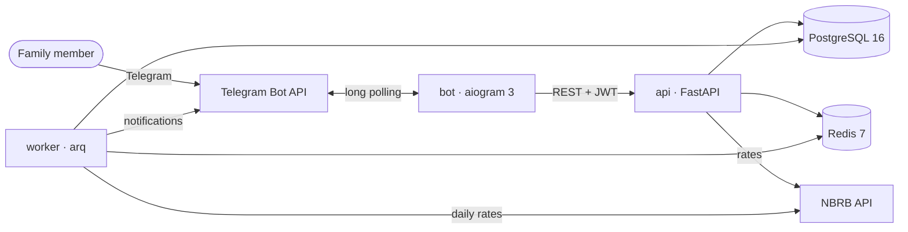

# Family P&L

[](https://github.com/R00tPengu1n/family-pnl/actions/workflows/ci.yml)

[Русская версия](README.ru.md)

A service for a family's shared finances. Every member records their own incomes and
expenses — in BYN, RUB or USD — and the whole family sees one picture: balances, spending
by category and by member, and how the monthly budget is going, each member in the
currency they choose. People use it through a Telegram bot; the bot is a client of a REST
API that holds all business logic.

## What it does

- **Households and roles.** Registration with email and password, or from the bot
  without a password. The owner invites members with one-time codes; data of another
  household is never visible (404, not 403).
- **Ledger.** Accounts (personal or shared), income and expense categories, operations in
  any of the three currencies, transfers between accounts.
- **Exchange rates.** Official rates of the National Bank of Belarus, stored per date;
  every amount is converted at the rate of its own date, exactly, and rounded once.
- **Budgets.** Monthly limits per expense category, prepared from the 20th to the 30th of
  the month before; the owner approves. Members get Telegram notifications at 80% and 100%
  of a limit; the owner gets a daily reminder while next month's budget is not approved.
- **Reports.** Totals, by category, by member and by month, plan vs actual, in the
  member's display currency; CSV export, and CSV import with an error for every bad cell.
- **Bot.** Quick entry (`кофе 5.50`, `такси 300 rub`, `+зарплата 2500 byn`), balance,
  monthly report, budget and limits, currency settings.

## Architecture



Details, the layers of the API and the decisions behind them:
[docs/architecture.md](docs/architecture.md) and [docs/adr/](docs/adr/).

Stack: Python 3.13, FastAPI, Pydantic v2, SQLAlchemy 2 (async) with asyncpg, Alembic,
PostgreSQL 16, Redis 7, arq, aiogram 3, httpx, structlog, uv; ruff, mypy (strict),
pytest; Docker and GitHub Actions.

## Engineering decisions

- **Exact money.** `Decimal` end to end, rates parsed from JSON without floats; each amount is
  converted at the rate of its own date and rounded once ([ADR-0008](docs/adr/0008-fx-conversion-rules.md)).
- **Notifications through an outbox.** An expense and the notification it triggers are written
  in one transaction; the worker delivers, retries with backoff and never repeats a member who
  already got it ([ADR-0009](docs/adr/0009-notifications-outbox.md)).
- **Household isolation.** Every query is scoped to the caller's household; foreign objects
  answer 404 like missing ones, covered by isolation tests ([ADR-0004](docs/adr/0004-household-isolation.md)).
- **Tokens.** Refresh tokens rotate on every use; reusing an old one revokes its whole family
  ([ADR-0005](docs/adr/0005-refresh-token-rotation.md)). Login attempts are counted atomically
  in Redis and the limiter fails open ([ADR-0006](docs/adr/0006-login-rate-limiting.md)).
- **A bot without database access.** The bot is an API client with the user's own rights; an
  import-linter contract forbids it to import the service ([ADR-0007](docs/adr/0007-bot-authentication.md)).
- **Quality gates in CI.** ruff, mypy strict, layer contracts, tests on real PostgreSQL with a
  coverage ratchet, mutation testing of the domain, gitleaks, Semgrep, pip-audit, Docker build.

## How it is built

The specification ([SPEC.md](SPEC.md)), the task plan ([tasks/](tasks/)) and the quality bar
([CONSTRAINTS.md](CONSTRAINTS.md)) are written first; most of the code is written by an AI
coding agent (Claude Code) working through that plan in small pull requests. Every pull
request passes the same automated gates, and decisions are recorded as ADRs.

## Run it with Docker

Requirements: Docker with Compose (Docker Desktop on Windows).

```bash
git clone https://github.com/R00tPengu1n/family-pnl.git
cd family-pnl
cp .env.example .env        # Windows PowerShell: Copy-Item .env.example .env
```

Edit `.env`: set `POSTGRES_PASSWORD`, `FAMILY_PNL_JWT_SECRET` and
`FAMILY_PNL_BOT_API_SECRET` (random strings, at least 32 characters:
`python -c "import secrets; print(secrets.token_urlsafe(48))"`), and
`FAMILY_PNL_TELEGRAM_BOT_TOKEN` from [@BotFather](https://t.me/BotFather) for the bot and
notifications. Then:

```bash
docker compose up --build -d
curl http://127.0.0.1:8000/health      # {"status":"ok","database":"ok"}
```

The API documentation is at <http://127.0.0.1:8000/docs>. Compose applies the migrations
first, then starts the API, the worker and the bot. Only the API port is published, on
localhost; set `API_BIND=0.0.0.0` in `.env` to expose it (behind a reverse proxy with
HTTPS). The bot restarts until the bot token is set; notifications wait in the database
until then.

## Develop

Requirements: [uv](https://docs.astral.sh/uv/) and Docker (for PostgreSQL and Redis).

```bash
uv sync                                          # dependencies, including dev
cp .env.example .env                             # the defaults match the dev database
docker compose -f docker-compose.dev.yml up -d   # PostgreSQL and Redis on localhost
uv run alembic upgrade head

uv run uvicorn --factory family_pnl.api.main:create_app --reload
uv run arq family_pnl.worker.settings.WorkerSettings
uv run python -m family_pnl_bot
```

Checks (the same as CI, except mutation testing, which runs in CI only):

```bash
uv run ruff check . && uv run ruff format --check .
uv run mypy
uv run lint-imports
uv run pytest -n 6 --dist loadgroup --cov
```

On Windows, `.\scripts\check.ps1 -Stage task` runs them all with the coverage gate and
the time budget from [CONSTRAINTS.md](CONSTRAINTS.md). Tests use real PostgreSQL and
Redis: the servers from `TEST_DATABASE_URL` / `TEST_REDIS_URL` if set, otherwise
throwaway containers.

## Configuration

All settings are environment variables with the `FAMILY_PNL_` prefix, read from `.env`;
[.env.example](.env.example) lists every one with its default and meaning. Secrets live
only in `.env` and in GitHub Secrets.

| Variable | Meaning |
|---|---|
| `FAMILY_PNL_DATABASE_URL` | `postgresql+asyncpg://…`; Compose sets it for the containers |
| `FAMILY_PNL_REDIS_URL` | Redis for login rate limiting and the job queue |
| `FAMILY_PNL_JWT_SECRET` | signing key of access tokens, 32+ characters |
| `FAMILY_PNL_BOT_API_SECRET` | shared by the API and the bot; the bot endpoints are off without it |
| `FAMILY_PNL_TELEGRAM_BOT_TOKEN` | the bot token; the worker sends notifications with it |
| `FAMILY_PNL_DEFAULT_TIMEZONE` | time zone of new households, `Europe/Minsk` |
| `FAMILY_PNL_BUDGET_WINDOW_START_DAY`, `…_END_DAY` | the approval window, 20 and 30 |

## Telegram bot

| Command | What it does |
|---|---|
| `/start` | creates an account and a household, or welcomes back |
| `/start <invite>` | joins the household of an invite code |
| `/link <code>` | links an existing API account (code from `POST /me/telegram-link-code`) |
| `/account Карта BYN [общий]` | opens a personal account, or a shared one (owner) |
| any text, e.g. `кофе 5.50` | records an expense; `+зарплата 2500 byn` records an income |
| `/balance` | balances and their total in the display currency |
| `/report` | this month's report, with buttons to other months |
| `/budget` | next month's draft and this month's spending; the owner approves here |
| `/limit продукты 800` | sets a limit in next month's budget |
| `/currency`, `/input` | display currency; currency of amounts typed without one |

Quick entry: the text before the amount is the category (matched ignoring case, or by
its beginning; otherwise the bot offers buttons), a comma works as the decimal point,
and the currency may be a word or a sign: `р`, `руб`, `бел`, `$`, `usd`… Every recorded
entry has an undo button.

## CSV import of operations

`POST /operations/import` with the file as the request body (`Content-Type: text/csv`).

- UTF-8 (a BOM is fine), comma or semicolon separated, at most 1 MiB and 5000 rows.
- A header row; columns in any order, names case-insensitive:

| Column     | Required | Value                                              |
|------------|----------|----------------------------------------------------|
| `date`     | yes      | `YYYY-MM-DD`                                       |
| `type`     | yes      | `income` or `expense` (transfers are not imported) |
| `amount`   | yes      | positive, a point before at most two decimals      |
| `account`  | yes      | account name as in the app                         |
| `category` | yes      | category name of the same kind as the type         |
| `currency` | no       | `RUB`, `BYN` or `USD`; empty means the account's   |
| `comment`  | no       | up to 500 characters                               |

```csv
date,type,amount,account,category,currency,comment
2026-10-20,expense,12.50,Card,Продукты,,Молоко
2026-10-20,income,2500,Card,Зарплата,BYN,
```

Names are matched ignoring case and surrounding spaces; an unknown or archived account or
category is an error, never created. Every bad cell is reported with its row (the header is
row 1), column and reason.

Query parameters: `strict=true` (default) imports nothing if any row is wrong, `strict=false`
imports the valid rows; `dry_run=true` checks everything and imports nothing.

The export, `GET /reports/export.csv?from=&to=`, has one figure per row (`section, month,
category, member, metric, amount, currency`), UTF-8 with a BOM for Excel.

## Limitations

- One household per user; no web or mobile client — the bot and the REST API.
- Members registered through the bot have no email or password yet, so they use the API
  only through the bot.
- Transfers are recorded through the API; the bot and the CSV import handle incomes and
  expenses.
- Currencies: BYN, RUB and USD, at NBRB rates.
- Bot questions waiting for a button press and `/link` attempt counters live in the bot's
  memory and are lost when it restarts.
- Deployment to a server, continuous deployment and backups are the next phase.

## License

The repository has no license file yet; the owner will choose one.
