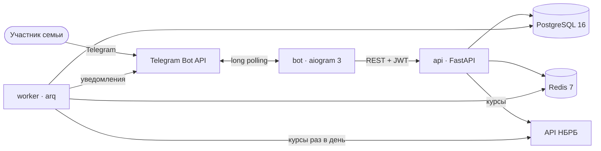

# Family P&L

[English version](README.md)

Сервис для общих финансов семьи. Каждый участник записывает свои доходы и расходы — в BYN,
RUB или USD, — а вся семья видит общую картину: балансы, траты по категориям и по
участникам, исполнение месячного бюджета, причём каждый — в той валюте, которую выбрал
сам. Пользуются сервисом через Telegram-бота; бот — клиент REST API, в котором вся
бизнес-логика.

## Возможности

- **Семьи и роли.** Регистрация по email и паролю или из бота без пароля. Владелец
  приглашает участников одноразовыми кодами; данные чужой семьи никогда не видны (404, а
  не 403).
- **Учёт.** Счета (личные и общие), категории доходов и расходов, операции в любой из трёх
  валют, переводы между счетами.
- **Курсы валют.** Официальные курсы Нацбанка Беларуси, хранятся по датам; каждая сумма
  пересчитывается по курсу своей даты, точно, с одним округлением.
- **Бюджеты.** Месячные лимиты по категориям расходов, готовятся с 20 по 30 число
  предыдущего месяца; утверждает владелец. Участники получают уведомления в Telegram при
  80% и 100% лимита; владелец — ежедневное напоминание, пока бюджет следующего месяца не
  утверждён.
- **Отчёты.** Итоги, по категориям, по участникам и по месяцам, план и факт — в валюте
  отображения участника; экспорт в CSV и импорт из CSV с ошибкой по каждой неверной ячейке.
- **Бот.** Быстрый ввод (`кофе 5.50`, `такси 300 rub`, `+зарплата 2500 byn`), баланс,
  отчёт за месяц, бюджет и лимиты, настройки валют.

## Архитектура



Подробности, слои API и принятые решения: [docs/architecture.md](docs/architecture.md)
(на английском) и [docs/adr/](docs/adr/).

Стек: Python 3.13, FastAPI, Pydantic v2, SQLAlchemy 2 (async) с asyncpg, Alembic,
PostgreSQL 16, Redis 7, arq, aiogram 3, httpx, structlog, uv; ruff, mypy (strict),
pytest; Docker и GitHub Actions.

## Запуск в Docker

Нужен Docker с Compose (на Windows — Docker Desktop).

```bash
git clone https://github.com/R00tPengu1n/family-pnl.git
cd family-pnl
cp .env.example .env        # Windows PowerShell: Copy-Item .env.example .env
```

В `.env` задайте `POSTGRES_PASSWORD`, `FAMILY_PNL_JWT_SECRET` и `FAMILY_PNL_BOT_API_SECRET`
(случайные строки не короче 32 символов:
`python -c "import secrets; print(secrets.token_urlsafe(48))"`) и
`FAMILY_PNL_TELEGRAM_BOT_TOKEN` от [@BotFather](https://t.me/BotFather) — для бота и
уведомлений. Затем:

```bash
docker compose up --build -d
curl http://127.0.0.1:8000/health      # {"status":"ok","database":"ok"}
```

Документация API — <http://127.0.0.1:8000/docs>. Compose сначала применяет миграции, потом
запускает API, воркер и бота. Наружу открыт только порт API и только на localhost; чтобы
открыть его в сеть, задайте `API_BIND=0.0.0.0` в `.env` (за обратным прокси с HTTPS). Без
токена бот перезапускается, а уведомления ждут в базе.

## Разработка

Нужны [uv](https://docs.astral.sh/uv/) и Docker (для PostgreSQL и Redis).

```bash
uv sync                                          # зависимости, включая dev
cp .env.example .env                             # значения по умолчанию подходят для dev-базы
docker compose -f docker-compose.dev.yml up -d   # PostgreSQL и Redis на localhost
uv run alembic upgrade head

uv run uvicorn --factory family_pnl.api.main:create_app --reload
uv run arq family_pnl.worker.settings.WorkerSettings
uv run python -m family_pnl_bot
```

Проверки (те же, что в CI, кроме мутационного тестирования — оно только в CI):

```bash
uv run ruff check . && uv run ruff format --check .
uv run mypy
uv run lint-imports
uv run pytest -n 6 --dist loadgroup --cov
```

На Windows `.\scripts\check.ps1 -Stage task` запускает всё вместе с порогом покрытия и
лимитом времени из [CONSTRAINTS.md](CONSTRAINTS.md). Тесты работают с настоящими
PostgreSQL и Redis: серверами из `TEST_DATABASE_URL` / `TEST_REDIS_URL`, если они заданы,
иначе с временными контейнерами.

## Настройки

Все настройки — переменные окружения с префиксом `FAMILY_PNL_`, читаются из `.env`;
в [.env.example](.env.example) перечислены все, со значениями по умолчанию и пояснениями.
Секреты хранятся только в `.env` и в GitHub Secrets.

| Переменная | Назначение |
|---|---|
| `FAMILY_PNL_DATABASE_URL` | `postgresql+asyncpg://…`; для контейнеров её задаёт Compose |
| `FAMILY_PNL_REDIS_URL` | Redis для ограничения попыток входа и очереди задач |
| `FAMILY_PNL_JWT_SECRET` | ключ подписи access-токенов, от 32 символов |
| `FAMILY_PNL_BOT_API_SECRET` | общий для API и бота; без него эндпоинты бота выключены |
| `FAMILY_PNL_TELEGRAM_BOT_TOKEN` | токен бота; им же воркер отправляет уведомления |
| `FAMILY_PNL_DEFAULT_TIMEZONE` | часовой пояс новых семей, `Europe/Minsk` |
| `FAMILY_PNL_BUDGET_WINDOW_START_DAY`, `…_END_DAY` | окно утверждения, 20 и 30 |

## Telegram-бот

| Команда | Что делает |
|---|---|
| `/start` | создаёт аккаунт и семью или здоровается снова |
| `/start <код>` | вступление в семью по коду приглашения |
| `/link <код>` | привязка существующего аккаунта API (код из `POST /me/telegram-link-code`) |
| `/account Карта BYN [общий]` | открывает личный счёт или общий (владелец) |
| любой текст, например `кофе 5.50` | записывает расход; `+зарплата 2500 byn` — доход |
| `/balance` | балансы и их итог в валюте отображения |
| `/report` | отчёт за этот месяц, кнопки — к другим месяцам |
| `/budget` | черновик следующего месяца и траты текущего; здесь же владелец утверждает |
| `/limit продукты 800` | лимит в бюджете следующего месяца |
| `/currency`, `/input` | валюта отображения; валюта сумм, набранных без валюты |

Быстрый ввод: текст перед суммой — категория (сравнивается без учёта регистра или по
началу названия; иначе бот предложит кнопки), запятая работает как десятичная точка,
валюта — словом или знаком: `р`, `руб`, `бел`, `$`, `usd`… У каждой записи есть кнопка
отмены.

## Импорт операций из CSV

`POST /operations/import`, файл — тело запроса (`Content-Type: text/csv`).

- UTF-8 (BOM допустим), разделитель — запятая или точка с запятой, не больше 1 МиБ и
  5000 строк.
- Строка заголовка; столбцы в любом порядке, имена без учёта регистра:

| Столбец    | Обязателен | Значение                                              |
|------------|------------|-------------------------------------------------------|
| `date`     | да         | `YYYY-MM-DD`                                          |
| `type`     | да         | `income` или `expense` (переводы не импортируются)    |
| `amount`   | да         | положительное, через точку, не больше двух знаков     |
| `account`  | да         | название счёта, как в приложении                      |
| `category` | да         | название категории того же вида, что и тип            |
| `currency` | нет        | `RUB`, `BYN` или `USD`; пусто — валюта счёта          |
| `comment`  | нет        | до 500 символов                                       |

```csv
date,type,amount,account,category,currency,comment
2026-10-20,expense,12.50,Card,Продукты,,Молоко
2026-10-20,income,2500,Card,Зарплата,BYN,
```

Названия сравниваются без учёта регистра и пробелов по краям; неизвестный или
архивный счёт или категория — ошибка, сами они не создаются. Каждая неверная ячейка
возвращается со строкой (заголовок — строка 1), столбцом и причиной.

Параметры запроса: `strict=true` (по умолчанию) — при любой ошибке ничего не
импортируется, `strict=false` — импортируются верные строки; `dry_run=true` — только
проверка.

Экспорт, `GET /reports/export.csv?from=&to=`, — по одной цифре в строке (`section, month,
category, member, metric, amount, currency`), UTF-8 с BOM для Excel.

## Ограничения

- Одна семья на пользователя; веб- и мобильного клиента нет — бот и REST API.
- У участников, зарегистрированных через бота, пока нет email и пароля, поэтому API им
  доступен только через бота.
- Переводы записываются через API; бот и импорт CSV работают с доходами и расходами.
- Валюты: BYN, RUB и USD, по курсам НБРБ.
- Вопросы бота, ожидающие нажатия кнопки, и счётчики попыток `/link` хранятся в памяти
  бота и теряются при его перезапуске.
- Развёртывание на сервере, автоматический деплой и резервные копии — следующий этап.

## Лицензия

Файла лицензии в репозитории пока нет; её выберет владелец.
