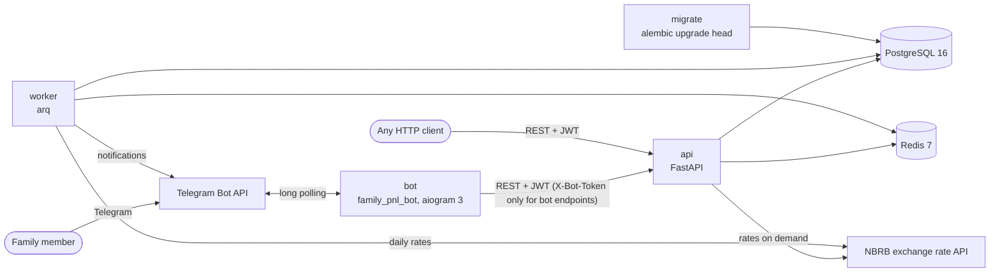
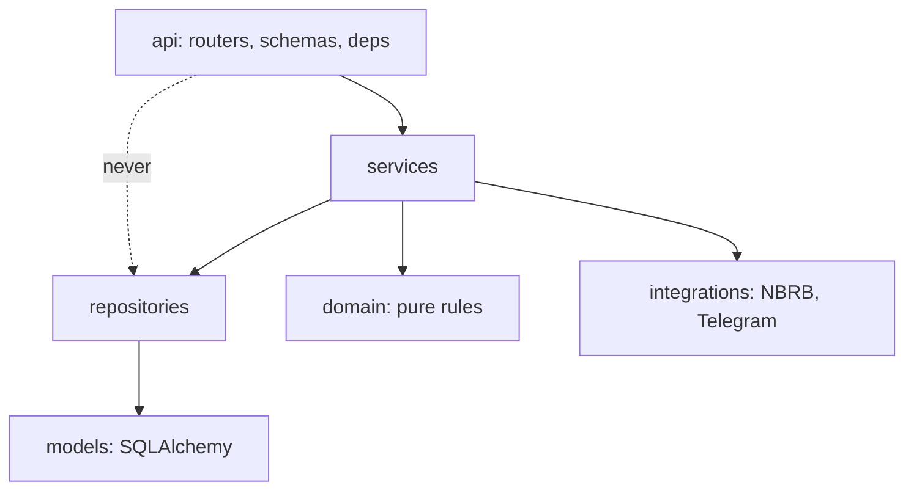

# Architecture

## Processes

- **api** holds all business logic. Every request is scoped to the caller's household;
  objects of another household answer 404, exactly like missing ones (ADR-0004).
- **bot** is only a client of the API and imports nothing from `family_pnl` (an
  import-linter contract). It identifies itself with a shared secret only to register,
  link and exchange a Telegram id for that user's access token; everything else runs with
  the user's own rights (ADR-0007).
- **worker** runs cron jobs: the daily NBRB rate refresh, delivery of outbox
  notifications every minute, and hourly checks for budget approval reminders (ADR-0001,
  ADR-0009).
- **migrate** applies Alembic migrations before the API and the worker start.

## Layers of the API

Dependencies point down only; `domain` imports no framework and does no I/O. The rules
are checked by import-linter in CI (ADR-0002).

## Data flow of an expense

1. The member writes `кофе 5.50` to the bot. The bot parses it, matches the category and
   the account, and calls `POST /operations` with the member's token.
2. The API records the operation. In the same transaction it computes the category's
   spending for the month in the budget currency (each expense at the rate of its own
   date, ADR-0008) and, at 80% or 100% of the limit, writes a notification to the outbox
   (ADR-0009).
3. Within a minute the worker sends the notification to every linked member of the
   household through the Telegram Bot API and marks it sent.

## Decisions

| ADR | Decision |
|---|---|
| [0001](adr/0001-arq-for-background-jobs.md) | arq for background jobs |
| [0002](adr/0002-layering-and-dependency-direction.md) | Layers and dependency direction |
| [0003](adr/0003-integration-test-database.md) | Real PostgreSQL in integration tests |
| [0004](adr/0004-household-isolation.md) | Household isolation: foreign objects are 404 |
| [0005](adr/0005-refresh-token-rotation.md) | Refresh token rotation and reuse detection |
| [0006](adr/0006-login-rate-limiting.md) | Login rate limiting that fails open |
| [0007](adr/0007-bot-authentication.md) | Bot authentication |
| [0008](adr/0008-fx-conversion-rules.md) | Exchange rates and conversion rules |
| [0009](adr/0009-notifications-outbox.md) | Notifications through a database outbox |
| [0010](adr/0010-bot-framework.md) | aiogram 3 for the bot, and pydantic 2.13 |
